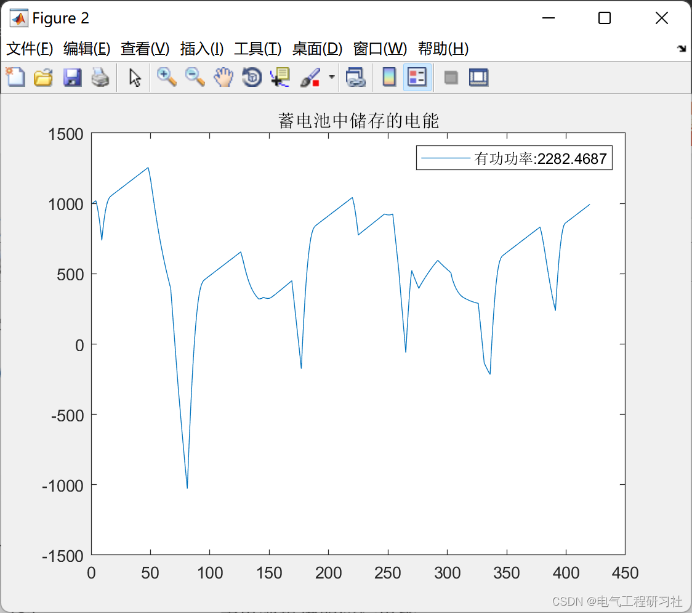
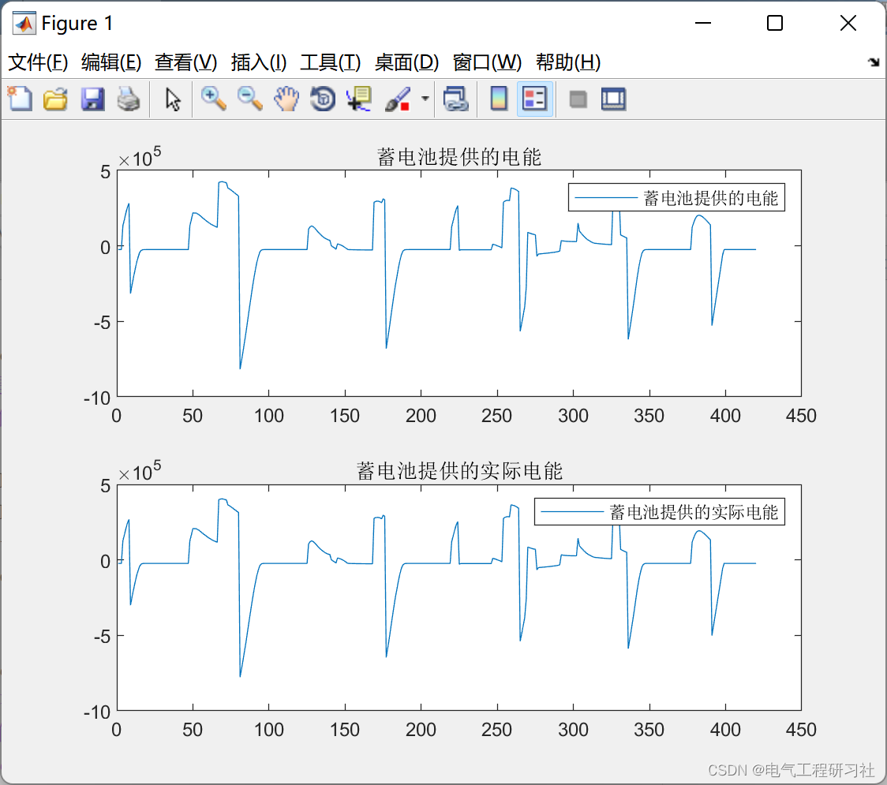
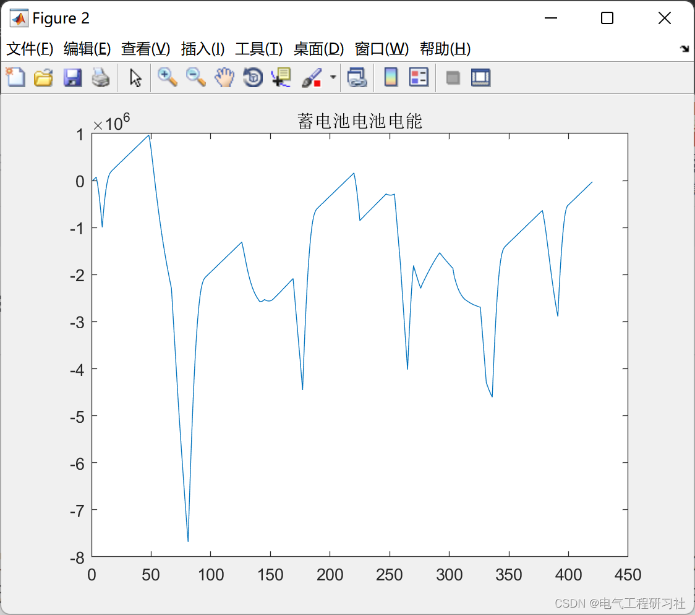
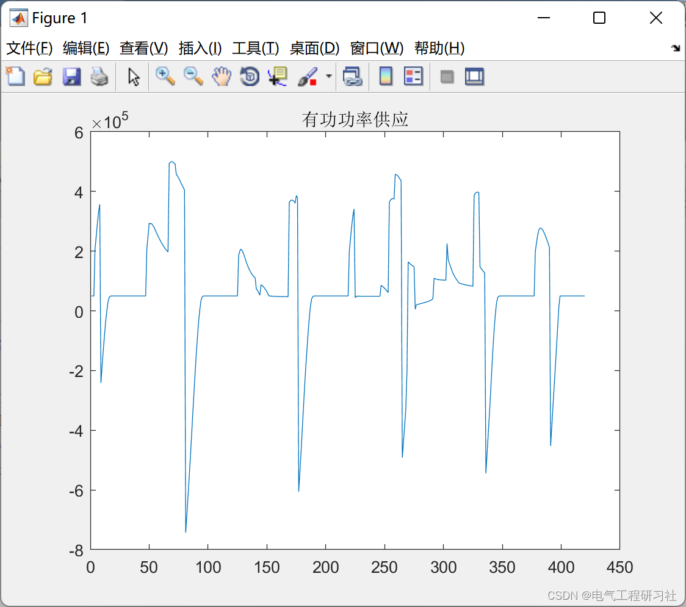
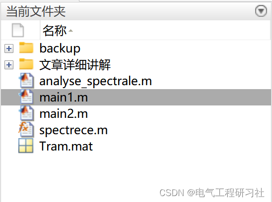

# Optimization of Microgrid and Electric Vehicle Battery (Matlab Code Realization)

Microgrid and Electric Vehicle Battery Optimization (Matlab Code Implementation)
1. Overview
In the context of global energy shortages and worsening environmental conditions, microgrids have become widely adopted due to their environmentally friendly and reliable characteristics. At the same time, the number of electric vehicles (EVs) that comply with the concept of energy conservation and low carbon is continuously increasing, making EV grid integration a popular research topic. However, due to the dual characteristics of EVs as sources and loads, and their random charging behavior, concentrated charging of a large number of EVs can impact the safety and economic operation of microgrids. With the prospect of high penetration rates of EVs into the grid, this paper thoroughly investigates the optimization dispatch strategy for flexible charging and discharging of EVs in the operation of microgrids.
2. Article Analysis
Details on this section are available in Part Four.
3. Running Results
Edit
Edit
Edit
Edit
4. Matlab Code and Explanation
This article only showcases part of the code; all codes are available in:

## Images

<!-- PAYMENT_BLOCK -->

## Get this dataset

- Payment link (Stripe): [Buy now](https://buy.stripe.com/3cs8yP7sY87d0vu9AB)
- Payment QR code: 

<!-- /PAYMENT_BLOCK -->
